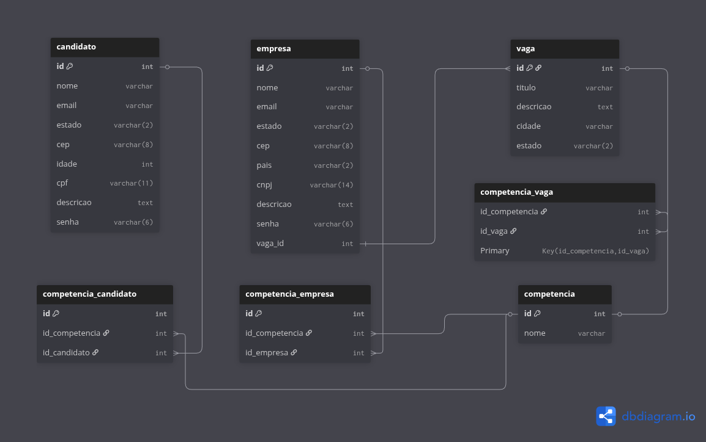

# Linketinder

**Desenvolvido por:** Augusto S. Lima

## 📋 Sobre o projeto

Linketinder conecta candidatos e empresas por meio de um backend em Groovy (CLI) e um frontend moderno em TypeScript. O frontend consome a API REST do backend, que persiste os dados no PostgreSQL.

## 🚀 Tecnologias

- Backend: Groovy 5, Gradle, API REST (HttpServer), testes com JUnit 5 + Mockito + H2
- Frontend: TypeScript, Vite, HTML5, CSS3, Fetch API (consome a API REST)
- Banco de dados: PostgreSQL 15+, scripts SQL versionados
- Ferramentas de apoio: IntelliJ IDEA, pgAdmin, dbdiagram.io
- API: JSON, Jackson ObjectMapper, CORS habilitado

## 🧭 Estrutura do projeto

```
Linketinder/
├── backend/
│   ├── build.gradle
│   ├── gradlew
│   └── src/
│       ├── main/groovy/com/augusto/linketinder/
│       │   ├── API/            # Controllers REST API
│       │   ├── control/        # Controllers da CLI
│       │   ├── dao/            # DAOs, factories e providers de conexão
│       │   ├── model/          # Modelos do domínio (pessoa, vaga, competência)
│       │   ├── service/        # Camada de serviço
│       │   ├── view/           # Views para interação via terminal
│       │   ├── App.groovy      # Entrada principal da aplicação CLI
│       │   └── Server.groovy   # Servidor HTTP da API REST (inicia HTTPServerAPI)
│       └── test/groovy/        # Testes (usa H2 in-memory)
├── frontend/
│   ├── index.html
│   ├── package.json
│   ├── tsconfig.json
│   └── src/
│       ├── components/         # Componentes reutilizáveis de UI
│       ├── factories/          # FormFactory, PageFactory, etc.
│       ├── handlers/           # FormHandler e orquestração de eventos
│       ├── helpers/            # Funções utilitárias (formHelper, homeHelper)
│       ├── models/             # Modelos/DTOs TypeScript
│       ├── pages/              # Páginas SPA (login, cadastro, home, menu)
│       ├── storage/            # Listas carregadas da API (src/api.ts faz as requisições)
│       └── validators/         # Cadeia de validadores (Chain of Responsibility)
├── database/
│   ├── scriptEstruturaBasica.sql
│   ├── scriptPopulacaoInicialDados.sql
│   └── MER-Inicial.png
└── README.md
```

## 🏗️ Arquitetura

### Backend (CLI + API REST em Groovy)
- **CLI**: Padrão MVC aplicado com controllers coordenando fluxo da linha de comando e views para interação textual.
- **API REST**: Controllers dedicados (`CandidatoControllerAPI`, `EmpresaControllerAPI`, `VagaControllerAPI`) implementando HttpHandler para servir endpoints JSON.
- **Camada de Serviço**: Services (`CandidatoService`, `EmpresaService`, `VagaService`) encapsulam lógica de negócio e são compartilhados entre CLI e API.
- **Serialização JSON**: Jackson ObjectMapper para conversão bidirecional entre objetos Groovy e JSON.
- **CORS**: Headers configurados para permitir integração com frontend em diferentes origens.
- **Validações**: Verificação de existência de recursos antes de atualizar/deletar.
- **Funções auxiliares**: Métodos `toJson()` e `mapTo*()` para transformação consistente de dados.
- Camada de dados desacoplada via `ConnectionProvider`. A `DAOFactory` injeta automaticamente `JDBCConnectionProvider` (PostgreSQL) ou `H2ConnectionProvider` (testes) conforme `DB_PROVIDER` ou `-DDB_PROVIDER=h2`.
- DAOs encapsulam SQL e trabalham com o provider selecionado, permitindo trocar o banco sem alterar regras de negócio.
- Testes utilizam banco H2 in-memory para garantir isolamento.

### Frontend (SPA em TypeScript)
- Estrutura SPA com roteamento simples (`src/router.ts`).
- Factories (`FormFactory`, `PageFactory`) constroem elementos on-demand, facilitando composição e testes.
- Validações seguem Chain of Responsibility (`validators/chain/*`), permitindo adicionar regras sem quebrar o fluxo.
- Handlers orquestram submissão e feedback de formulários, apoiados por helpers e models tipados.

### Banco de Dados (PostgreSQL)
O banco de dados foi modelado seguindo as melhores práticas de normalização e integridade referencial:

#### Estrutura do Banco
- **7 Tabelas principais**: competencia, candidato, empresa, vaga, competencia_candidato, competencia_vaga, competencia_empresa
- **Normalização**: Atende até a 4ª Forma Normal (4FN)
- **Relacionamentos**: N:N entre entidades através de tabelas associativas
- **Integridade**: Chaves estrangeiras com CASCADE para manter consistência

#### Modelo Entidade-Relacionamento (MER)



**Principais entidades e relacionamentos:**
- **Candidato** possui múltiplas competências (N:N via competencia_candidato)
- **Empresa** possui múltiplas competências (N:N via competencia_empresa)
- **Vaga** pertence a uma empresa (N:1) e requer múltiplas competências (N:N via competencia_vaga)
- **Competência** é compartilhada entre candidatos, empresas e vagas

## 🧩 Padrões de projeto em uso
- **Factory**: `DAOFactory`, `DataSourceFactory`, `FormFactory`, `PageFactory`.
- **DAO**: encapsula persistência e mantém controllers enxutos.
- **Service Layer**: camada intermediária entre controllers e DAOs, compartilhada entre CLI e API.
- **Provider**: `ConnectionProvider` para abstrair fonte de dados (JDBC x H2).
- **Handler**: `HttpHandler` para processamento de requisições HTTP na API REST.
- **Chain of Responsibility**: validadores sequenciais no frontend.
- **DRY (Don't Repeat Yourself)**: funções auxiliares reutilizáveis (`*ToJson`, `mapTo*`, `*Exists`).
- **Strategy**: diferentes estratégias de serialização/deserialização via Jackson.

## ⚙️ Funcionalidades

### Backend (CLI + API REST Groovy)
**CLI:**
- ✅ Cadastro de candidatos e empresas via linha de comando
- ✅ Visualização de registros
- ✅ Gerenciamento CRUD completo
- ✅ Sistema de competências
- ✅ Integração com PostgreSQL e H2 (testes)

**API REST:**
- ✅ Endpoints RESTful completos para Candidatos, Empresas e Vagas
- ✅ Operações CRUD via HTTP (GET, POST, PUT, DELETE)
- ✅ Serialização/Deserialização JSON automática
- ✅ Validações de existência de recursos
- ✅ Suporte a relacionamentos (competências e vagas)
- ✅ CORS habilitado para integração frontend
- ✅ Logs detalhados de requisições e respostas
- ✅ Tratamento de erros com códigos HTTP apropriados

### Frontend (Web TypeScript)
- ✅ Interface web responsiva
- ✅ Sistema de login/cadastro
- ✅ Páginas dedicadas para candidatos e empresas
- ✅ Formulários interativos com validação em cadeia
- ✅ Gráficos e visualizações
- ✅ Dados carregados da API REST; login com senha e token na sessão (sessionStorage)
- ✅ Roteamento SPA

### Banco de Dados (PostgreSQL)
- ✅ Estrutura normalizada até 4FN
- ✅ Relacionamentos N:N com tabelas associativas
- ✅ Integridade referencial com constraints
- ✅ Scripts automatizados de criação e população
- ✅ Suporte a múltiplas competências por entidade

## 🛠️ Como executar

### Backend (Groovy)
Pré-requisitos: JDK 8+ e Gradle Wrapper (já incluso).

**Executar CLI:**
```bash
cd backend
./gradlew run            # executa a CLI

# Rodar testes (os testes de DAO já usam H2 em memória; não exporte DB_PROVIDER=h2,
# pois dois testes verificam o provider padrão)
./gradlew test
```

**Executar API REST:**
```bash
cd backend
./gradlew installDist    # compila e copia o projeto + dependências para build/install

# Inicia o servidor (porta padrão: 8080)
java -cp "build/install/linketinder-backend/lib/*" com.augusto.linketinder.Server

# Ou especifica uma porta diferente
java -cp "build/install/linketinder-backend/lib/*" com.augusto.linketinder.Server 9090

# Ou usa variável de ambiente
PORT=9090 java -cp "build/install/linketinder-backend/lib/*" com.augusto.linketinder.Server
```

> 📖 Para mais detalhes sobre execução e configuração do backend, consulte [backend/README.md](backend/README.md)

### Frontend (TypeScript)
Pré-requisitos: Node.js 16+ e npm.

```bash
cd frontend
npm install
npm run dev       # modo desenvolvimento (http://localhost:5173); a API precisa estar rodando
# Para outra URL da API: VITE_API_URL=http://localhost:9090 npm run dev
npm run build     # build produção
npm run preview   # serve build de produção
```

### Banco de Dados (PostgreSQL)

**Pré-requisitos:**
- PostgreSQL 15+ instalado
- pgAdmin 4 (opcional, para interface gráfica)
- Acesso ao terminal PostgreSQL (psql)

**Configuração inicial:**

```bash
# (re)criar banco — apaga os dados existentes
psql -U postgres -c "DROP DATABASE IF EXISTS linketinder;"
psql -U postgres -c "CREATE DATABASE linketinder;"

# criar estrutura
psql -U postgres -d linketinder -f database/scriptEstruturaBasica.sql

# popular dados iniciais
psql -U postgres -d linketinder -f database/scriptPopulacaoInicialDados.sql
```

**Verificar instalação:**
```sql
-- Conectar ao banco
psql -U postgres -d linketinder

-- Verificar tabelas criadas
\dt

-- Consultar dados
SELECT * FROM candidato;
SELECT * FROM empresa;
SELECT * FROM vaga;
```

**Estrutura criada:**
- 7 tabelas relacionadas
- 5 candidatos (personagens de The Office)
- 5 empresas
- 5 vagas de emprego
- 6 competências técnicas
- Relacionamentos configurados entre todas as entidades
- Senha de todos os usuários de exemplo: `123456` (salva como hash PBKDF2)

## 🌐 Acesso à Aplicação

### Backend
**CLI:**
- **Tipo**: Interface de linha de comando
- **Execução**: Via terminal após executar `./gradlew run`

**API REST:**
- **Tipo**: Servidor HTTP
- **URL base**: `http://localhost:8080`
- **Formato**: JSON
- **CORS**: Habilitado para todas as origens

### Frontend
- **Tipo**: Aplicação web (SPA)
- **URL de desenvolvimento**: `http://localhost:5173` (após `npm run dev`)
- **Funcionalidades**: Interface completa com login, cadastros e visualizações

### Banco de Dados
- **Tipo**: PostgreSQL
- **Porta padrão**: 5432
- **Nome do banco**: linketinder
- **Acesso via pgAdmin**: `http://localhost:5050` (se configurado)
- **Acesso via psql**: `psql -U postgres -d linketinder`

## 🔌 API REST - Endpoints

A API REST implementada fornece endpoints completos para gerenciamento de Candidatos, Empresas e Vagas, seguindo as melhores práticas RESTful.

### 📋 Estratégia de Implementação

A API foi desenvolvida utilizando uma arquitetura em camadas com separação clara de responsabilidades:

1. **Controllers (HttpHandler)**: Processam requisições HTTP, validam entrada e coordenam respostas
2. **Services**: Encapsulam lógica de negócio e orquestram chamadas aos DAOs
3. **DAOs**: Gerenciam persistência e acesso ao banco de dados
4. **Models**: Representam as entidades do domínio

**Padrões e práticas aplicadas:**
- ✅ **Funções auxiliares reutilizáveis**: `*ToJson()` para serialização, `mapTo*()` para deserialização, `*Exists()` para validações
- ✅ **DRY (Don't Repeat Yourself)**: Eliminação de código duplicado através de funções centralizadas
- ✅ **Validação de recursos**: Verificação de existência antes de operações de atualização e remoção
- ✅ **Tratamento de erros**: Respostas HTTP apropriadas (404, 500) com mensagens descritivas
- ✅ **Conversão automática de tipos**: Maps JSON → Objetos Groovy e vice-versa
- ✅ **Relacionamentos**: Suporte completo a listas aninhadas (competências, vagas)
- ✅ **CORS**: Configurado para permitir integração com frontends em diferentes origens

### 🔐 Autenticação

- Senhas são salvas como hash **PBKDF2 (HMAC-SHA256)** com salt aleatório (`AuthService`), nunca em texto puro, e nunca aparecem nas respostas da API.
- `POST /login` com `{"cpf": "...", "senha": "..."}` (candidato) ou `{"cnpj": "...", "senha": "..."}` (empresa) retorna `{"token", "tipo", "id"}`; credenciais erradas retornam `401`.
- Envie o token no header `Authorization: Bearer <token>` para rotas protegidas: `PUT`/`DELETE` em candidatos e empresas e `POST`/`PUT`/`DELETE` em vagas. Cadastro (`POST /candidatos`, `POST /empresas`) e todos os `GET` são públicos.
- Cada usuário só altera/remove o próprio perfil, e cada empresa só cria/altera/remove as próprias vagas; caso contrário a API retorna `403`.
- Os tokens valem 8 horas e ficam só em memória: vencer ou reiniciar o servidor exige novo login (o frontend volta ao menu automaticamente).
- `GET /competencias` lista as competências (`id`, `nome`) usadas nos cadastros.

```bash
curl -X POST http://localhost:8080/login -d '{"cpf":"12345678901","senha":"123456"}'
curl -X DELETE http://localhost:8080/candidatos/1 -H "Authorization: Bearer <token>"
```

### 👤 Candidatos

**Base URL:** `/candidatos`

| Método | Endpoint | Descrição | Body |
|--------|----------|-----------|------|
| GET | `/candidatos` | Lista todos os candidatos | - |
| GET | `/candidatos/{id}` | Busca candidato por ID | - |
| POST | `/candidatos` | Cria novo candidato | JSON |
| PUT | `/candidatos/{id}` | Atualiza candidato | JSON |
| DELETE | `/candidatos/{id}` | Remove candidato | - |

**Exemplo POST - Criar Candidato:**
```bash
curl -X POST http://localhost:8080/candidatos \
  -H "Content-Type: application/json" \
  -d '{
    "nome": "João Silva",
    "email": "joao@example.com",
    "estado": "SP",
    "cep": "01234-567",
    "cpf": "123.456.789-00",
    "idade": 25,
    "descricao": "Desenvolvedor Full Stack",
    "senha": "senha123",
    "competencias": [
      {"id": 1, "nome": "Angular"},
      {"id": 2, "nome": "Java"}
    ]
  }'
```

**Exemplo PUT - Atualizar Candidato:**
```bash
curl -X PUT http://localhost:8080/candidatos/1 \
  -H "Content-Type: application/json" \
  -d '{
    "nome": "João Silva Atualizado",
    "email": "joao.novo@example.com",
    "descricao": "Desenvolvedor Full Stack Sênior"
  }'
```

**Exemplo DELETE:**
```bash
curl -X DELETE http://localhost:8080/candidatos/1
```

### 🏢 Empresas

**Base URL:** `/empresas`

| Método | Endpoint | Descrição | Body |
|--------|----------|-----------|------|
| GET | `/empresas` | Lista todas as empresas | - |
| GET | `/empresas/{id}` | Busca empresa por ID | - |
| POST | `/empresas` | Cria nova empresa | JSON |
| PUT | `/empresas/{id}` | Atualiza empresa | JSON |
| DELETE | `/empresas/{id}` | Remove empresa | - |

**Exemplo POST - Criar Empresa com Vagas:**
```bash
curl -X POST http://localhost:8080/empresas \
  -H "Content-Type: application/json" \
  -d '{
    "nome": "Tech Solutions LTDA",
    "email": "contato@techsolutions.com",
    "estado": "SP",
    "cep": "01310-100",
    "pais": "Brasil",
    "cnpj": "12.345.678/0001-90",
    "descricao": "Empresa de tecnologia",
    "senha": "senha123",
    "competencias": [
      {"id": 1, "nome": "Angular"},
      {"id": 2, "nome": "Java"}
    ],
    "vagas": [
      {
        "nome": "Desenvolvedor Full Stack",
        "descricao": "Vaga para desenvolvedor com experiência",
        "cidade": "São Paulo",
        "estado": "SP",
        "competencias": [
          {"id": 1, "nome": "Angular"},
          {"id": 2, "nome": "Java"}
        ]
      }
    ]
  }'
```

**⚠️ Importante:** Ao criar uma empresa, NÃO envie `id` ou `id_empresa` nas vagas. Esses campos são gerados automaticamente.

**Exemplo PUT - Atualizar Empresa:**
```bash
curl -X PUT http://localhost:8080/empresas/1 \
  -H "Content-Type: application/json" \
  -d '{
    "nome": "Tech Solutions LTDA - Atualizada",
    "email": "novo@techsolutions.com"
  }'
```

### 💼 Vagas

**Base URL:** `/vagas`

| Método | Endpoint | Descrição | Body |
|--------|----------|-----------|------|
| GET | `/vagas` | Lista todas as vagas | - |
| GET | `/vagas/{id}` | Busca vaga por ID | - |
| POST | `/vagas` | Cria nova vaga | JSON |
| PUT | `/vagas/{id}` | Atualiza vaga | JSON |
| DELETE | `/vagas/{id}` | Remove vaga | - |

**Exemplo POST - Criar Vaga:**
```bash
curl -X POST http://localhost:8080/vagas \
  -H "Content-Type: application/json" \
  -d '{
    "id_empresa": 1,
    "nome": "Desenvolvedor Full Stack Pleno",
    "descricao": "Vaga para desenvolvedor com experiência",
    "cidade": "São Paulo",
    "estado": "SP",
    "competencias": [
      {"id": 1, "nome": "Angular"},
      {"id": 2, "nome": "Java"}
    ]
  }'
```

**⚠️ Importante:** O campo `id_empresa` é obrigatório e deve referenciar uma empresa existente.

**Exemplo PUT - Atualizar Vaga:**
```bash
curl -X PUT http://localhost:8080/vagas/1 \
  -H "Content-Type: application/json" \
  -d '{
    "nome": "Desenvolvedor Full Stack Sênior",
    "cidade": "Rio de Janeiro"
  }'
```

### 📊 Respostas da API

**Sucesso (200/201):**
```json
{
  "message": "Recurso criado/atualizado com sucesso",
  "id": 1,
  "data": { }
}
```

**Erro (404):**
```json
{
  "error": "Recurso não encontrado",
  "status": 404
}
```

**Erro (500):**
```json
{
  "error": "Erro interno",
  "status": 500
}
```

### 🔧 Testando a API

**Usando cURL:**
```bash
# Listar todos os candidatos
curl http://localhost:8080/candidatos

# Buscar candidato específico
curl http://localhost:8080/candidatos/1
```

**Usando ferramentas gráficas:**
- Postman
- Insomnia
- Thunder Client (VS Code)
- HTTPie

**Arquivos de teste inclusos:**
- `backend/test-candidato.json` - Exemplo para criar candidato
- `backend/test-update-candidato.json` - Exemplo para atualizar candidato
- `backend/test-empresa.json` - Exemplo para criar empresa com vagas
- `backend/test-update-empresa.json` - Exemplo para atualizar empresa
- `backend/test-vaga.json` - Exemplo para criar vaga
- `backend/test-update-vaga.json` - Exemplo para atualizar vaga

## ✅ Funcionalidades atuais
- Cadastro, listagem e atualização básica de candidatos, empresas, vagas e competências pela CLI.
- Interface web com páginas de login, cadastro, dashboard e gráficos.
- Validação de formulários com cadeia configurável de regras.
- Scripts SQL para criação e seed inicial do banco.

## 🎯 Objetivo do Projeto

O Linketinder visa criar uma ponte entre candidatos e empresas através de:
- Interface intuitiva e moderna (frontend web)
- Sistema robusto de gerenciamento (backend CLI)
- Banco de dados estruturado e normalizado
- Futuro sistema de matching inteligente baseado em competências
- Experiência completa de recrutamento

## 📋 Funcionalidades detalhadas

### Frontend web
1. Login com CPF/CNPJ e senha, autenticado pela API (token Bearer).
2. Fluxos de cadastro distintos para candidatos e empresas.
3. Dashboard do candidato com listagem de vagas e gráficos de competências.
4. Dashboard da empresa com gestão de vagas e visualização de candidatos.
5. SPA com roteamento sem recarregar a página.

### Banco de dados
1. **Tabela Candidato**: Armazena informações pessoais e profissionais
2. **Tabela Empresa**: Dados cadastrais das empresas recrutadoras
3. **Tabela Vaga**: Descrição das oportunidades de trabalho
4. **Tabela Competência**: Catálogo de habilidades técnicas
5. **Tabelas Associativas**: Relacionam competências com candidatos, empresas e vagas
6. **Constraints de Integridade**: Garantem consistência dos dados
7. **Cascata de Operações**: Atualizações e deleções propagadas automaticamente

## 🚧 Próximos Passos

- [x] **API REST**: Endpoints completos para Candidatos, Empresas e Vagas ✅
- [x] **Integração Backend-Frontend**: Conectar frontend TypeScript com a API REST
- [ ] **Connection Pool**: Configurar pool de conexões eficiente (ex.: HikariCP)
- [ ] **Sistema de Matching**: Algoritmo de compatibilidade baseado em competências
- [ ] **Autenticação JWT**: Sistema de autenticação robusto
- [ ] **Testes End-to-End**: Cobertura completa do fluxo de integração
- [ ] **Queries Otimizadas**: Implementar índices e otimizar consultas
- [ ] **Deploy**: Preparar para produção
- [ ] **Documentação OpenAPI/Swagger**: Documentação interativa da API

## 📝 Notas Técnicas

- **Arquitetura**: Projeto modularizado com separação clara entre backend (CLI + API REST), frontend e database
- **Backend CLI**: Utiliza Banco de Dados conectado em PostgreSQL com arquitetura MVC
- **Backend API**: HttpServer nativo do Java com controllers RESTful, serialização JSON via Jackson
- **Camada de Serviço**: Services compartilhados entre CLI e API para reutilização de lógica de negócio
- **Frontend**: Consome a API REST (`VITE_API_URL`, padrão `http://localhost:8080`); só o token de login fica no sessionStorage
- **Banco de Dados**: PostgreSQL com estrutura normalizada até 4FN
- **Modelagem**: Desenvolvida em dbdiagram.io e exportada para SQL
- **Build System**: Gradle para o backend, Vite para o frontend
- **Testes**: Estrutura preparada para testes unitários em Groovy com suporte a H2
- **Compatibilidade**: Frontend responsivo para diferentes dispositivos
- **Design Patterns**: Factory, DAO, Service Layer, Provider, Chain of Responsibility, Handler, Strategy, DRY
- **API**: RESTful, JSON, CORS habilitado, validações de recursos, tratamento de erros HTTP

## 🤝 Contribuições

Sinta-se à vontade para contribuir com:
- Melhorias na interface
- Novas funcionalidades
- Otimizações no banco de dados
- Correções de bugs
- Integração backend-frontend

## 📄 Licença

Este projeto foi desenvolvido para fins educacionais.

---

**Desenvolvido por Augusto S. Lima**